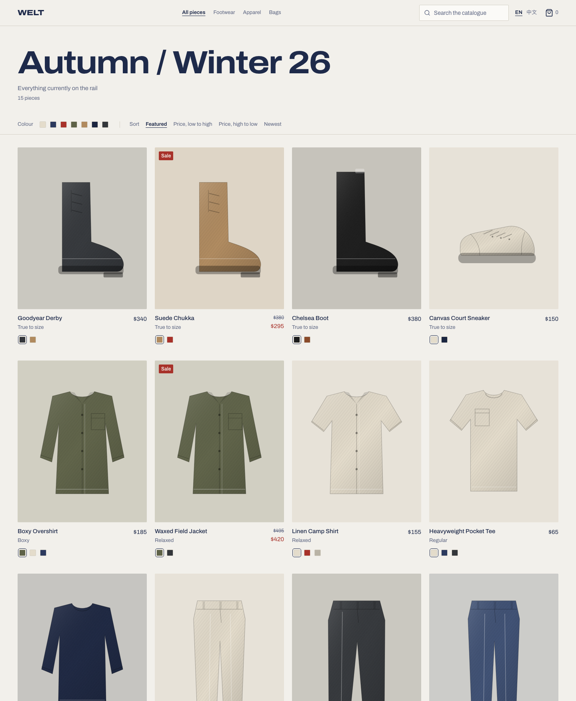

# WELT Storefront

面向海外消费者的电商前台 Demo。**商品数据全部 mock，不含后端**，重点放在架构分层、状态归属与多语言这三件事上。

桌面端与移动端同一套响应式代码，中英双语，购物袋跨刷新保留。



录屏演示：[桌面端](docs/demo/desktop-walkthrough.mp4) · [移动端](docs/demo/mobile-walkthrough.mp4)

## 能做什么

- **商品列表** —— 分类、搜索、排序、色系筛选，全部筛选状态存在 URL 里，可分享、可后退、刷新不丢
- **商品详情** —— 色卡换色、尺码矩阵（售罄尺码划线禁用）、库存提示、加入购物袋
- **购物袋抽屉** —— 改数量、删除、小计、结算按钮占位并明确标注不在范围内
- **中英切换** —— 语言在 URL 前缀，商品文案随语言解析

## 技术栈

| 项 | 选型 | 说明 |
| --- | --- | --- |
| 构建 | Vite 8 | |
| 框架 | React 19 | |
| 语言 | TypeScript 6 | 默认开启 strict |
| 路由 | React Router 8 | 语言在 URL 前缀 |
| 状态 | Redux Toolkit 2 + RTK Query | 服务端状态走缓存，购物车为客户端真值 |
| 多语言 | i18next 26 + react-i18next 17 | 按语言分文件，`zh.ts` 用 `typeof en` 约束 |
| 样式 | Tailwind 4 | 自托管 Archivo 变量字体，用宽度轴做品牌声音 |
| 无障碍原语 | Radix UI | 抽屉的焦点陷阱、Esc、滚动锁 |
| Lint | Oxlint | |

## 跑起来

```bash
npm install
npm run dev      # http://localhost:5173，会自动跳到 /en 或 /zh
npm run build    # tsc -b && vite build
npm run lint
```

## 架构要点

这几个决定是这个项目真正想演示的东西。

**1. 状态按归属分三层，不混在一个 store 里**

| 状态 | 例子 | 放在哪 |
| --- | --- | --- |
| URL 状态 | 语言、分类、筛选、排序、搜索词 | 路由 path / searchParams |
| 服务端状态 | 商品列表、详情、分类 | RTK Query（缓存、去重、失效） |
| 客户端状态 | 购物袋、抽屉开关 | Redux slice |

把商品列表也用 `createAsyncThunk` 手写 `loading/error/data` 三件套，会得到每个接口一套样板代码，外加一堆手写的缓存与竞态处理。URL 状态放 URL，则是为了可分享和可后退 —— 语言尤其如此，它是唯一真值，不镜像进 store。

**2. 商品文案和界面文案分开**

商品名、描述、细节是**内容**，跟着 catalogue 按 locale 解析（真实后端也是这么返回的）；按钮、标签、属性词表是**界面文案**，走 i18n 文件。混在一起的话，搜索就没法按用户正在读的语言匹配。

`zh.ts` 被声明为 `typeof en`，所以漏译一个 key 会让 `tsc` 直接失败，而不是把英文丢给中文用户。

**3. 金额以整数「分」存储**

`3499` 而不是 `34.99`。购物车里加十个浮点数会漂。格式化一律交给 `Intl.NumberFormat`，货币符号位置和千分位跟随 locale。

**4. 购物车存 SKU，不存商品副本**

行里只有 `variantId` + 数量 + 加购时的价格快照。标题、图片、实时价格从 catalogue join 回来。快照唯一的用途是**提示变价**，而不是显示一个悄悄过期的总价。购物车行的粒度是 SKU（颜色 × 尺码），这是电商最容易返工的一处。

**5. 持久化是手写的**

`redux-persist` 的最新版仍是 2019 年 9 月的 `6.0.0`，早于 RTK 2 和 React 19 时代。购物车只是一串标量，三十行带 `version` 校验和迁移兜底的读写比审计一个七年前的依赖划算。

**6. 连点不会丢计数**

数量增减由 reducer 基于当前 store 状态计算，而不是接收渲染时算好的数量 —— 否则同一帧内的连点会因为闭包里的旧值而互相覆盖。

**7. mock 层是异步契约，不是静态 import**

`src/features/catalog/api.ts` 里每个函数都返回 Promise 并带 220–520ms 人工延迟，响应结构按真实服务设计（内容按 locale 解析、入参做白名单校验）。换成 `fetch` 或 MSW，改这一个文件就够。

**8. 商品图是程序化生成的**

没有摄影素材，错配的图库照片比没有图更糟。于是每件商品按版型参数生成 SVG 平铺线稿，用色卡的染液上色，叠加斜纹与织物噪点。副作用是：卡片上换色是瞬时重绘，不是图片加载。

## 目录结构

```
src/
├── app/                    store、router、布局外壳、错误页
├── features/
│   ├── catalog/            类型、mock 数据、api 契约、RTK Query、列表页、详情页
│   ├── cart/               slice、持久化、selector、抽屉
│   ├── locale/             语言切换
│   └── ui/                 UI slice（抽屉开合）
├── shared/
│   ├── lib/                cn、金额格式化、locale、URL 构造
│   └── ui/                 Button、Sheet、Swatch、QuantityStepper
└── i18n/                   i18next 配置与 en/zh 文案
```

## 已知取舍与未做的部分

- **纯 CSR，没有 SSR 或预渲染**，商品页对搜索引擎基本不可见。这是唯一「将来要重做地基」的部分 —— 如果这个 Demo 要长成真实的独立站，渲染模式是第一个要换的东西，而不是最后一个。
- **没有结算、登录、订单**。结算按钮存在但禁用，并在界面上说明了原因，而不是假装能点。
- **没有自动化测试**。最该补的两处是金额计算和购物车 reducer —— 这两个出 bug 是静默的，且金额错了会被一眼看穿。
- **未做路由级代码分割**，当前单页 565 kB（gzip 182 kB）。
- **无障碍只做了基础**：语义化标签、键盘可达、焦点可见、`aria-live` 播报加购。没有正式审计。
- 商品插画是技术线稿风格，其中靴子与球鞋两款版型偏符号化，还没细调。
